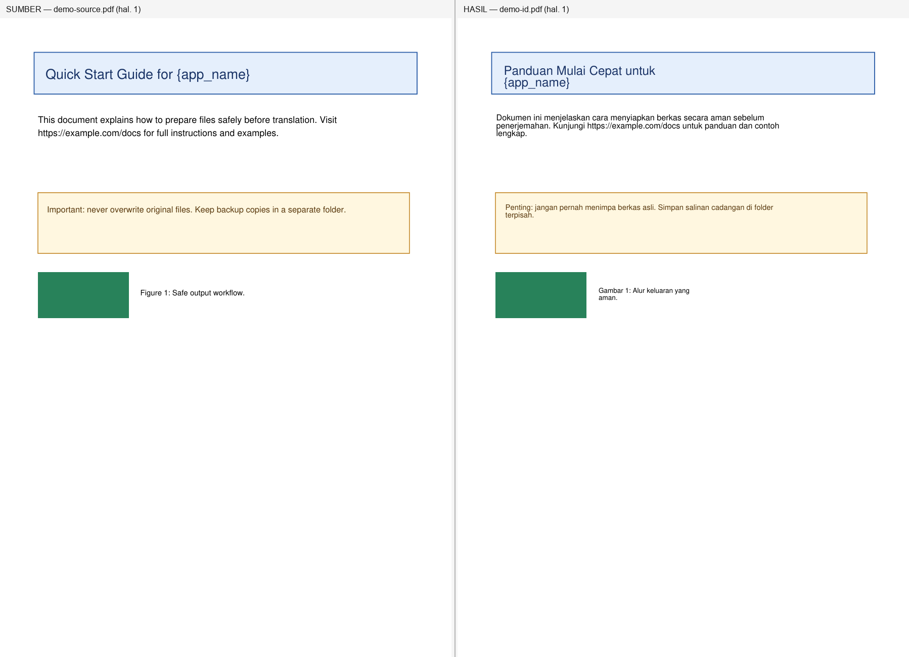
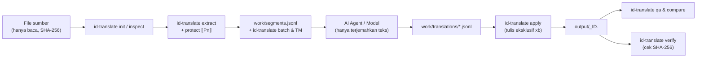

# terjemahan-id (`id-translate`)

Panduan, skill (`agentskills.io`), aturan (`AGENTS.md`), dan CLI deterministik Python untuk membantu
AI agent (Codex, Claude Code, Cursor, Antigravity, Copilot) menerjemahkan dokumen ke **Bahasa Indonesia**
secara konsisten, dengan tata letak terjaga dan **tanpa pernah menimpa file asli**.

> Bahasa Inggris / English summary: [README.en.md](README.en.md)

## Masalah vs Solusi

| Masalah saat meminta AI agent menerjemahkan file | Solusi `id-translate` |
|---|---|
| Agent menulis ulang skrip ekstraksi/penulisan tiap sesi → boros token dan hasilnya tidak konsisten. | **Model hanya menerjemahkan teks**; CLI deterministik mengurus ekstraksi, masking placeholder, penulisan ulang, dan QA. |
| File sumber atau hasil sebelumnya tak sengaja tertimpa. | Setiap keluaran dibuat secara eksklusif (`open(..., "xb")`) di folder baru `hasil-terjemahan/<nama>_ID_<waktu>/` dengan hash SHA-256 sumber. |
| Placeholder (`{name}`, `%1$s`), URL, kode, atau rumus Excel ikut rusak/diterjemahkan. | Token pelindung (`⟦P1⟧`) di-mask sebelum dikirim ke model dan divalidasi sebelum file hasil ditulis. |
| File terenkripsi atau ber-DRM diproses sembarangan. | PDF terenkripsi, Office terenkripsi (OLE), dan EPUB ber-DRM ditolak sejak awal (exit code `4`); tidak ada kode dekripsi/penghapusan DRM. |

## Quick Start (3 langkah)

```bash
# 1. Pasang paket inti (Python >= 3.10; tambah extra sesuai format yang dibutuhkan)
pip install -e .
# Opsional: pip install -e ".[office,yaml,compare]"  # dan ".[pdf]" bila perlu PDF (lihat catatan lisensi)

# 2. Siapkan folder hasil aman dan ekstrak segmen
id-translate init tests/fixtures/sample.md
id-translate extract tests/fixtures/sample.md --result hasil-terjemahan/sample_ID_<waktu>

# 3. Setelah model/agent mengisi work/translations/*.jsonl, terapkan, jalankan QA, lalu verifikasi
id-translate apply --result hasil-terjemahan/sample_ID_<waktu>
id-translate qa tests/fixtures/sample.md hasil-terjemahan/sample_ID_<waktu>/output/sample_ID.md
id-translate verify hasil-terjemahan/sample_ID_<waktu>
```

Untuk pemakaian bersama AI agent, simpan [AGENTS.md](AGENTS.md) dan folder
[skills/translate-id/](skills/translate-id/SKILL.md) di proyek Anda, lalu perintahkan agent:
> Terjemahkan `panduan.docx` ke Bahasa Indonesia memakai skill `translate-id` dan ikuti `AGENTS.md`.
> Berhenti setelah glosarium dan setelah pilot untuk persetujuanku.

Detail instalasi dan penunjuk tipis untuk Claude Code, Cursor, Gemini/Antigravity, dan Copilot ada di
[docs/getting-started.md](docs/getting-started.md).

## Demo terminal nyata

Cuplikan berikut direkam dari eksekusi nyata `id-translate` (v0.1.0.dev0) terhadap fixture bawaan
[tests/fixtures/sample.md](tests/fixtures/sample.md):

```text
$ id-translate init sample.md
...\hasil-terjemahan\sample_ID_20261126-174507

$ id-translate extract sample.md --result ...\sample_ID_20261126-174507
{
  "format": "markdown",
  "segments": 18,
  "pending": 18,
  "skip": 0,
  "chars_pending": 600,
  "estimated_input_tokens": 156,
  "segments_file": "...\\work\\segments.jsonl"
}

# Contoh segmen 1 (placeholder {app_name} dilindungi sebagai ⟦P1⟧):
{"id": "md0001", "type": "heading", "text": "Getting Started with ⟦P1⟧", "protect": {"⟦P1⟧": "{app_name}"}, "status": "pending"}

$ id-translate verify ...\sample_ID_20261126-174507
OK source unchanged (sha256 00246588f9680c09...): ...\sample.md
OK output unchanged: ...\hasil-terjemahan\sample_ID_20261126-174507\output\sample_ID.md
```

### Demo perbandingan visual PDF (`id-translate compare`)

Hasil nyata `id-translate compare` pada fixture PDF buatan sendiri (kotak berwarna, gambar raster,
placeholder `{app_name}`, dan URL tetap utuh):



## Format dan status (jujur)

| Format | Ekstensi | Status | Extra opsional | Catatan & dokumentasi |
|---|---|---|---|---|
| Markdown & teks polos | `.md`, `.markdown`, `.txt` | **beta** | *(inti, stdlib)* | [docs/formats/markdown-text.md](docs/formats/markdown-text.md) |
| Subtitle | `.srt`, `.vtt` | **beta** | *(inti, stdlib)* | Jaga cue/timestamp; QA cek baris & CPS ([docs/formats/subtitles.md](docs/formats/subtitles.md)) |
| Lokalisasi i18n | `.json`, `.arb`, `.po`, `.pot`, Android `strings.xml` | **beta** | *(inti, stdlib)* | [docs/formats/i18n.md](docs/formats/i18n.md) |
| YAML | `.yaml`, `.yml` | **beta** | `[yaml]` (PyYAML) | Edit in-place, jaga komentar ([docs/formats/i18n.md](docs/formats/i18n.md)) |
| Office OOXML | `.docx`, `.pptx`, `.xlsx` | **beta** | `[office]` (lxml) | XML langsung; rumus XLSX & file OLE terenkripsi aman ([docs/formats/office.md](docs/formats/office.md)) |
| Web & e-book | `.html`, `.htm`, `.xhtml`, `.epub` | **beta** | *(inti, stdlib)* | Tolak EPUB ber-DRM; jaga `mimetype` ([docs/formats/html-epub.md](docs/formats/html-epub.md)) |
| PDF (text layer) | `.pdf` | **beta** | `[pdf]` (PyMuPDF) | Prototipe; auto-fit maks −10%, flag overflow ([docs/formats/pdf.md](docs/formats/pdf.md)) |
| Format lain (`.doc`, `.ppt`, `.xls`, `.odt`, `.idml`, `.ass`, Apple `.strings`) | — | **planned** | — | Belum didukung |

Semua format yang sudah terimplementasi masih berstatus **beta** pada tahap `0.1.0.dev0` hingga
melewati evaluasi menyeluruh (Fase 5) dan rilis `v0.1.0`.

## Arsitektur ringkas



Detail lengkap kontrak segmen, lapisan abstraksi mesin PDF, dan alur checkpoint ada di
[docs/architecture.md](docs/architecture.md).

## Lisensi dan peringatan PyMuPDF

- Lisensi repositori ini **belum ditetapkan** (menunggu keputusan pemilik; lihat
  [docs/license-decision.md](docs/license-decision.md)).
- Mesin PDF bawaan memakai **PyMuPDF** sebagai dependensi **opsional** (`[pdf]`) dan **tidak
  di-vendor** di repositori ini. PyMuPDF berlisensi ganda **GNU AGPL-3.0** atau **lisensi komersial
  Artifex**. Pengguna yang memasang atau mendistribusikan extra `[pdf]` bertanggung jawab penuh
  mematuhi syarat lisensi PyMuPDF. Lihat [THIRD_PARTY_NOTICES.md](THIRD_PARTY_NOTICES.md) dan
  [docs/security-and-copyright.md](docs/security-and-copyright.md).

## Keterbatasan jujur (belum didukung)

- **Tidak menjamin terjemahan tanpa salah.** `id-translate qa` bersifat heuristik; tinjauan visual
  dan sampel terjemah-balik manual tetap wajib.
- **PDF hasil scan / tanpa text layer**: terdeteksi di `inspect`, tetapi OCR tidak dijalankan
  otomatis dan fidelity tata letak jauh lebih rendah.
- **Teks di dalam gambar, judul chart/SmartArt OOXML**: tidak diedit otomatis.
- **PDF multi-kolom rapat / tabel kompleks**: teks Indonesia cenderung 15–25% lebih panjang; bila
  melebihi batas auto-fit −10%, blok diperluas agar teks tidak terpotong dan ditandai di `review_flags`.
- **Format belum didukung**: Office biner lama (`.doc`, `.ppt`, `.xls`), OpenDocument (`.odt`,
  `.odp`, `.ods`), InDesign (`.idml`), subtitle `.ass`/`.ssa`, dan Apple `.strings`.

## FAQ

- **Apakah file asli saya aman?** Ya: semua operasi penulisan memakai `open(..., "xb")` sehingga
  gagal (exit `4`) bila target sudah ada, dan `id-translate verify` memeriksa ulang SHA-256 sumber.
- **Bisakah dipakai tanpa PyMuPDF?** Ya. Semua format non-PDF berjalan tanpa PyMuPDF.
- **Mengapa tidak ada `id-translate translate` yang memanggil API LLM?** Sengaja: repo ini memberi
  mesin berkas yang deterministik agar agent/pengguna bebas memilih model sendiri tanpa mengirim
  dokumen ke layanan pihak ketiga secara diam-diam.

## Roadmap

- Fase 0–4: audit, mesin deterministik 15 ekstensi + prototipe PDF, skill `agentskills.io` &
  validator, dokumentasi & peta klaim, CI & kepatuhan lisensi.
- Fase 5: suite evaluasi (`evals/`) ≥ 15 kasus uji tata letak dengan pseudo-translation.
- Fase 6: persiapan rilis `v0.1.0`.

## Dokumentasi terkait

- [Panduan mulai](docs/getting-started.md) · [Arsitektur](docs/architecture.md) · [Glosarium](docs/glossary-howto.md)
- [Panduan gaya Indonesia](docs/style-guide-id.md) · [QA](docs/qa.md) · [Pemecahan masalah](docs/troubleshooting.md)
- [Evaluasi](docs/evals.md) · [Isu yang diketahui](docs/known-issues.md) · [Catatan rilis v0.1.0](docs/releases/v0.1.0.md)
- [Keamanan & hak cipta](docs/security-and-copyright.md) · [Peta klaim README](docs/claims.md) · [Kredit](docs/credits.md)
- [Kontribusi](CONTRIBUTING.md) · [Kode etik](CODE_OF_CONDUCT.md) · [Keamanan](SECURITY.md) · [Changelog](CHANGELOG.md)
