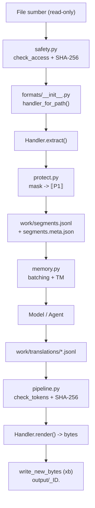

# Arsitektur `id-translate`

## Prinsip desain
1. **Pemisahan peran:** AI agent/model hanya menerjemahkan teks; kode Python deterministik mengurus
   parsing, proteksi token, penulisan ulang format, perbandingan visual, dan pemeriksaan QA.
2. **Invarian keselamatan terpusat:** semua penulisan file melewati `id_translate.safety.write_new_bytes`
   (`open(..., "xb")`). Handler format tidak pernah menulis ke disk secara langsung — mereka hanya
   mengembalikan `bytes` baru.
3. **Dependensi minimal dan terisolasi:** format teks/web/lokalisasi memakai stdlib. `lxml`,
   `PyYAML`, `Pillow`, dan `PyMuPDF` dimuat secara malas (*lazy import*) lewat extra opsional.

## Diagram alur

## Kontrak segmen (`id-translate/segments@1`)

Setiap baris di `work/segments.jsonl` adalah objek JSON:

| Bidang | Tipe | Makna |
|---|---|---|
| `id` | string | Pengenal stabil dan unik dalam satu file (mis. `md0001`, `dx0012`, `pdf0003`) |
| `type` | string | Jenis unit (`paragraph`, `heading`, `list_item`, `table_cell`, `cue`, `string`, `attr`, `block`, …) |
| `text` | string | Teks sumber yang sudah di-mask dengan token seperti `⟦P1⟧` atau `⟦S1⟧…⟦/S1⟧` |
| `style` | object | Petunjuk gaya/konteks (level heading, durasi cue, font/ukuran PDF, konteks ARB/PO) |
| `loc` | object | Lokasi pasti di file sumber (offset karakter, part XML + indeks, halaman + `bbox`) |
| `protect` | object | Peta token → literal asli (`{"⟦P1⟧": "{name}"}`) yang dipulihkan saat `apply` |
| `status` | string | `pending` (harus diterjemahkan) atau `skip` (tidak ada huruf yang diterjemahkan) |

File pendamping `segments.meta.json` menyimpan `schema`, `format`, `source_path`, dan `source_sha256`.
Saat `apply`, hash sumber diverifikasi ulang agar segmen tidak pernah diterapkan ke file yang berubah.

## Lapisan abstraksi mesin PDF

`src/id_translate/pdf/__init__.py` mendefinisikan kelas abstrak `PdfEngine`. `PdfHandler` hanya
berkomunikasi lewat antarmuka ini sehingga backend PDF bawaan (`PyMuPdfEngine`, extra `[pdf]`) dapat
diganti lewat `register_engine()` atau variabel lingkungan `ID_TRANSLATE_PDF_ENGINE` tanpa mengubah
kontrak segmen maupun CLI.

## Exit code CLI

| Kode | Arti |
|---|---|
| `0` | Berhasil |
| `1` | Pemeriksaan gagal (`qa` menemukan error / `verify` mendeteksi perubahan) |
| `2` | Kesalahan argumen CLI |
| `3` | Kesalahan masukan (file tidak ada, format tidak didukung/rusak) |
| `4` | Penolakan keselamatan (akan menimpa file, sumber berubah, input terenkripsi/DRM) |
| `5` | Dependensi opsional belum terpasang |
| `6` | Kesalahan validasi (segmen belum lengkap, token `⟦Pn⟧` rusak/hilang) |
